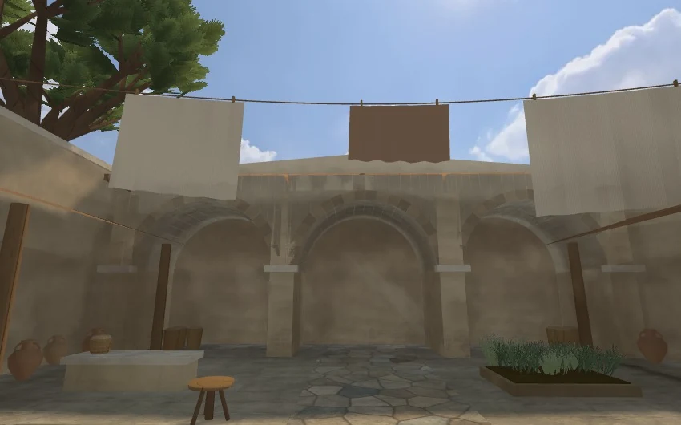

# Ancient Rome

The default walk explores the Forum Boarium around AD 10. The district map also links to Vicus Aureus, the original imagined neighborhood. Buildings, boats, stalls, vegetation, paving, and water are generated locally in JavaScript and rendered with WebGPU.

## Forum Boarium reconstruction

The ground plane uses metres east and south of 41.88900° N, 12.48084° E. The main rectangle of Portunus, the circular colonnade of Hercules Victor, and the alignment of the surviving Ponte Rotto provide the three registration points. The walk uses the relative positions of those landmarks. Elevations, reconstructed roofs and bridge spans, shoreline, shops, cargo and animals are interpretive.

| Reference | Use in this walk |
| --- | --- |
| [Temple of Portunus, Smarthistory](https://smarthistory.org/temple-of-portunus/) and [Portunus, Digital Augustan Rome](https://www.digitalaugustanrome.org/records/portunus-aedes/) | Approximate 10.5 × 19 metre temple, four frontal Ionic columns, engaged columns, and the north-facing approach |
| [Round Temple by the Tiber, Digital Augustan Rome](https://www.digitalaugustanrome.org/records/round-temple-tiberis/) and [Forum Boarium guide, World Monuments Fund](https://www.wmf.org/sites/default/files/article/pdfs/forumboarium_guide_2017_eng.pdf) | Twenty Corinthian columns, circular sanctuary, raised site and east-facing door |
| [Pons Aemilius, Digital Augustan Rome](https://www.digitalaugustanrome.org/records/pons-aemilius/) | Connection across the Tiber and the surviving span |
| [Modern Portunus footprint](https://www.openstreetmap.org/way/251331418), [Hercules footprint](https://www.openstreetmap.org/way/251342364) and [Ponte Rotto](https://www.openstreetmap.org/relation/6384861) | Footprint alignment © OpenStreetMap contributors, [ODbL](https://www.openstreetmap.org/copyright) |
| [Procedural real-world cities, r/proceduralgeneration](https://www.reddit.com/r/proceduralgeneration/comments/1u95069/procedural_realworld_cities_in_pure_python_real/) | Technical reference for fitting generated architecture to real footprints |
| [Creating a procedural world with varying terrain, r/proceduralgeneration](https://www.reddit.com/r/proceduralgeneration/comments/12zxtby/) | Broad noise variations used to vary the placement of finer surface detail |
| [Effective Water Simulation from Physical Models, Mark Finch](https://developer.nvidia.com/gpugems/gpugems/part-i-natural-effects/chapter-1-effective-water-simulation-physical-models) | Long geometric waves and fine, distance-filtered surface ripples |
| [Black Bull, Grab3D](https://grab3d.com/models/animals/bull/) | CC0 cattle model adapted to 2,198 triangles, baked vertex colours and two coat variations. Modern visual reference for the illustrative pen |

## Market Street and courtyard

The connected shop block, taller residence, potter’s workshop, loading porch, and merchants’ courtyard are interpretive reconstructions for the walk around AD 10. Their locations and household details illustrate everyday activity. The cistern, storage bays, baskets, work stool, pottery shelves, carrying frame, lamp, and pegged laundry are generated locally. The gate and courtyard gallery have modeled arch barrels. The map uses their actual collision footprints.

[Walk along Market Street](https://maltais239.github.io/interactives/worlds/ancient-rome/?stop=market-street) or [enter the merchants’ courtyard](https://maltais239.github.io/interactives/worlds/ancient-rome/?stop=merchants-courtyard).

## Shared materials and Vicus Aureus assets

The following assets from [Poly Haven](https://polyhaven.com/license) are available under CC0. Compact derivatives are served alongside the game.

| Asset | Artist | Use |
| --- | --- | --- |
| [Old Sandstone 02](https://polyhaven.com/a/old_sandstone_02) | Dimitrios Savva | Dressed stone and flagstones |
| [Plastered Wall 04](https://polyhaven.com/a/plastered_wall_04) | Rob Tuytel | Lime plaster |
| [Brick Wall 04](https://polyhaven.com/a/brick_wall_04) | Dimitrios Savva, Dario Barresi and Rico Cilliers | Aqueduct and boundary walls |
| [Stone Tiles](https://polyhaven.com/a/stone_tiles) | Christopher Melani | Side streets and garden paths |
| [Sparse Grass](https://polyhaven.com/a/sparse_grass) | Amal Kumar | Garden soil |
| [Kloofendal 48d Partly Cloudy](https://polyhaven.com/a/kloofendal_48d_partly_cloudy) | Greg Zaal | Upper sky panorama |
| [Lion Head](https://polyhaven.com/a/lion_head) | Tina | Adapted sculptural ornament on the fountain |

The street stones combine a locally generated pattern of fitted paving and cut blocks with mineral grain from the credited limestone scan. Colour, surface relief, and roughness follow the same stone edges. The house fronts, shutters, paintwork, and door fittings are interpretive.

[Compare the house fronts and street paving from the same walking viewpoints.](street-comparison.webp)

The four scanned architectural surfaces share two small atlases. The second stores tangent-space normal X and Y and roughness. The lion uses a 2,400-triangle mesh with baked occlusion.

## Landmark assets

[Colosseum model by Colosseum.how](https://www.colosseum.how/3d-model), published by Artur Jakucewicz. The AD 80 GLB is stored with lossless compression in [assets/landmarks](assets/landmarks/README.md). Placement in the walk is pending.
