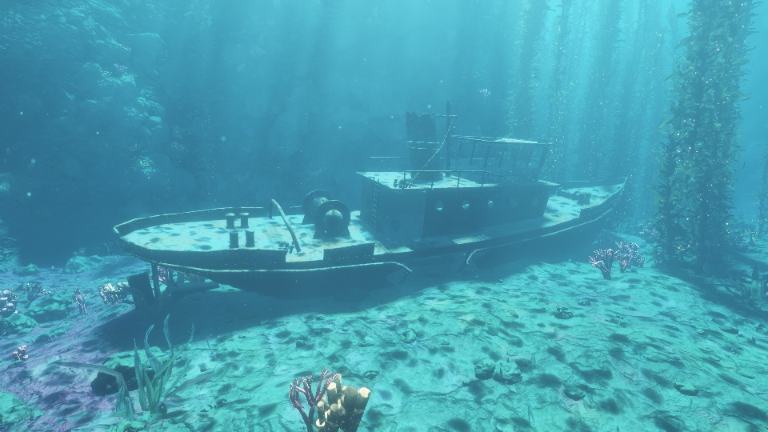

# Abyssal Garden

Created by **Maksymilian Dendura (Noniv)**.

Original source and project documentation are at [Noniv/abyssal-garden](https://github.com/Noniv/abyssal-garden).

This version extends the underwater world with four loggerhead turtles, three blacktip reef sharks, one great white shark, nine goldfish, six jellyfish, four garibaldi, five kelp bass, and a school of 24 Pacific sardines. The turtle meshes use curved cross-sections in `wildlife.js`. A Web Worker generates the shark and goldfish meshes and colors on the device using [Procedural Animals](https://github.com/majidmanzarpour/threejs-procedural-animals) by Majid Manzarpour and contributors. `marine-life.js` adapts their swim tables to the kelp routes and shades the animals in WebGPU. The default dive generates its wildlife on the device. The three kelp-forest fish have species-specific body profiles, fins, colouring, and tail beats in `kelp-fish.js`.

The Alder is a fictional sidewheel steamer grounded on the southwest shelf. The dive tracker can guide you to all three wrecks. The Alder waypoint leads through the broken hull beneath its stern deck. [Dive beside the Alder](https://maltais239.github.io/interactives/worlds/kelp-garden/?site=alder&turtle=green).

[Dive beside the Kestrel](https://maltais239.github.io/interactives/worlds/kelp-garden/?site=tug&turtle=green), or select **WWII harbour tug** in the dive tracker. The fictional 35-metre tug lies east of the Alder in about 43 metres of water. Its raised pilothouse, single funnel and towing gear draw on the [National Park Service survey of the 1943 Army tug LT-5](https://npgallery.nps.gov/GetAsset/e9120f48-938b-4319-a008-ca0db8d77e2a). The starboard breach exposes the engine and the stern still carries its three-bladed screw. The geometry is built on the device in `harbour-tug.js`.

At startup, `reef-routes.js` charts the rendered seabed, rock outcrops, props and wrecks. It checks a whole loop with clearance for the animal or school, then fits that loop into open water before the renderer and tracker use it.

The [green sea turtle preview](https://maltais239.github.io/interactives/worlds/kelp-garden/?turtle=green) starts beside one of the four turtles. It loads a local adaptation of [tevy’s Sea Turtle v1](https://tevy.dev/models/sea-turtle), released under [CC0 1.0](https://creativecommons.org/publicdomain/zero/1.0/). The asset retains the source mesh, skin weights, colour and normal maps, and swim and glide clips. The WebGPU renderer plays the source foreflipper stroke and articulates both rear flippers, shoulders, and neck through each turn. Stroke phase controls forward surges, and the tracker samples the same diving path and body orientation as the renderer.

The bundled worker is generated from `marine-worker-entry.js` and the upstream project at commit [c95ae493](https://github.com/majidmanzarpour/threejs-procedural-animals/tree/c95ae49346aa8e140a924376cec6cf0073d99512). Its header includes the upstream MIT notice. To rebuild, check out that revision and run `npx esbuild@0.28.2 marine-worker-entry.js --bundle --minify --format=esm --target=es2022 --alias:procedural-animals=/absolute/path/to/upstream --outfile=marine-worker.js --banner:js="$(printf '/*\n'; cat /absolute/path/to/upstream/LICENSE; printf '*/')"`.

Copyright (c) 2026 Maksymilian Dendura. See [LICENSE](LICENSE).

Open the [GitHub Pages build](https://maltais239.github.io/interactives/worlds/kelp-garden/) in a browser with WebGPU support. For local development, serve this folder over HTTP.
